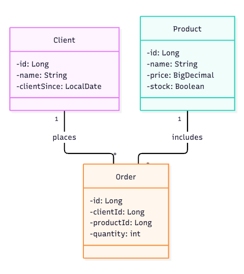

# Trabalho Desenvolvimento WEB Back-End com Java

## Tecnologias utilizadas
- Java 17
- SpringBoot 4.1
- Spring Data JPA
- MySQL 8.0
- Docker

## Descrição
CRUD para controle de clientes, produtos e pedidos.

## Inicialização
### Criar arquivo .env, copiando os dados do .env-example
```bash
cp .env-example .env
```

### Subir container MySQL
```bash
docker compose up -d
```

## End-points

### Clientes

| Método | Endpoint        | Descrição                        | Body JSON                              |
| ------ | --------------- | -------------------------------- |----------------------------------------|
|        | `/clients`      | Lista todos os clientes          | --                                     |
|        | `/clients/{id}` | Busca um cliente pelo ID         | --                                     |
|        | `/clients`      | Cadastra um novo cliente         | (all) name: string, clientSince: date  |
|        | `/clients/{id}` | Atualiza parcialmente um cliente | (some) name: string, clientSince: date |
|        | `/clients/{id}` | Exclui um cliente                | --                                     |

---

## Produtos

### Endpoints disponíveis

| Método | Endpoint         | Descrição                        | Body JSON                                           |
| ------ | ---------------- | -------------------------------- |-----------------------------------------------------|
|        | `/products`      | Lista todos os produtos          | --                                                  |
|        | `/products/{id}` | Busca um produto pelo ID         | --                                                  |
|        | `/products`      | Cadastra um novo produto         | (all) name: string, price: decimal, stock: boolean  |
|        | `/products/{id}` | Atualiza parcialmente um produto | (some) name: string, price: decimal, stock: boolean |
|        | `/products/{id}` | Exclui um produto                | --                                                  |


---

## Pedidos

### Endpoints disponíveis

| Método | Endpoint         | Descrição                     | Body JSON                                                       |
| ------ |------------------|-------------------------------|-----------------------------------------------------------------|
|        | `/orders`        | Lista todos os pedidos        | --                                                              |
|        | `/orders/{id}` | Busca um pedido pelo ID       | --                                                              |
|        | `/orders`      | Cadastra um novo pedido       | (all) clientId: integer, productId: integer, quantity: integer  |
|        | `/orders/{id}` | Atualiza parcialmente um pedido | (some) clientId: integer, productId: integer, quantity: integer |
|        | `/orders/{id}` | Exclui um pedido              | --                                                              |

## Diagrama UML
